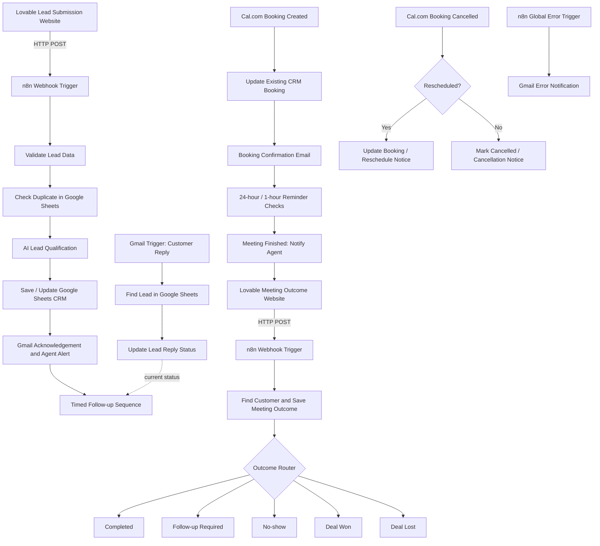

# Real Estate Lead Management & Appointment Automation System

An n8n-based automation system for US residential real estate teams. It connects website lead capture, AI-assisted lead qualification, Google Sheets CRM management, email follow-up, Cal.com appointment events, meeting outcome tracking, and centralized error notifications.

The system uses two Lovable-built web forms as the user-facing interfaces:

- **Lead submission website:** https://trusty-form-retry.lovable.app/
- **Meeting outcome website:** https://customer-meeting-momentum.lovable.app/

> **Project status:** Independent portfolio demonstration. The workflows and integrations are being tested with sample data. The Lovable webhook-based form submissions and the updated Cal.com event handling require end-to-end acceptance testing before the system should be described as production-ready. This is not a live client deployment.

---

## Overview

Real estate teams need more than a form that collects enquiries. They need a consistent process to validate and qualify new prospects, keep customer records current, follow up, detect replies, coordinate appointments, handle cancellations or rescheduling, and record meeting outcomes.

This project demonstrates that process using five n8n workflows. Google Sheets is used as the demonstration CRM, Gmail handles customer and agent communication, Cal.com supplies appointment events, and an AI/LLM step assists with lead qualification.

## Workflow Architecture



## Workflows

### 1. Lead Capture, AI Qualification & Follow-Up

**Entry point:** Lovable lead submission website sends an HTTP `POST` request to an n8n Webhook Trigger.

Main steps:

1. Receive lead form data through the webhook.
2. Validate the required fields, email address, phone number, and consent.
3. Search Google Sheets for an existing lead to reduce duplicate records.
4. Use an AI/LLM step to assist with lead qualification and summary generation.
5. Process the AI response and save the lead information to Google Sheets.
6. Send the configured customer acknowledgement and agent notification through Gmail.
7. Run timed follow-up steps, re-checking the latest CRM status before sending subsequent messages.

The website form is intended to capture:

- Full name
- Email address
- Phone number
- Intent (Buy, Sell, or Rent)
- Preferred location
- Budget range
- Additional details
- Consent to be contacted

Example lead payload (sample data only):

```json
{
  "fullName": "Jordan Smith",
  "email": "jordan@example.com",
  "phone": "+12025550123",
  "intent": "Buy",
  "preferredArea": "Washington, DC",
  "budgetRange": "$600,000-$1,000,000",
  "additionalNotes": "Looking for a two-bedroom home.",
  "consent": true
}
```

### 2. Appointment Booking, Cancellation & Reminder Automation

**Appointment platform:** Cal.com.

The workflow screenshot shows separate Cal.com booking-created and booking-cancelled trigger paths.

**New booking path:**

- Receive the booking-created event.
- Find the existing customer in Google Sheets.
- Update that customer's booking details and active booking status.
- Store the booking identifier for later reminder verification.
- Send the appointment confirmation email.
- Run the scheduled reminder sequence.

**Cancellation and rescheduling path:**

- Receive the booking-cancelled event.
- Check whether the cancellation is associated with a rescheduling operation.
- For a reschedule, use the rescheduling branch and send the appropriate notification.
- For a genuine cancellation, update the appointment status and send a cancellation confirmation.
- Keep the appointment status separate from the customer's sales lead status.

**Reminder protection:** Before sending reminders, the workflow retrieves the latest CRM row and checks that the booking identifier still matches the current booking and that the booking is still marked as `Booked`.

> **Cal.com payload note:** Confirm the exact booking ID field, cancellation/reschedule indicator, and replacement-booking relationship against real Cal.com trigger executions. Do not reuse Calendly-specific payload fields or invitee URI mappings without verifying that Cal.com provides equivalent fields.

### 3. Meeting Outcome & Sales Pipeline Management

**Entry point:** The agent uses the Lovable meeting outcome website, which sends an HTTP `POST` request to a second n8n Webhook Trigger.

The workflow finds the existing customer record, saves the meeting notes and outcome, and routes the result through a Switch node.

| Meeting outcome | CRM action | Notification |
|---|---|---|
| Meeting Completed | Record the completed meeting outcome and status | Customer thank-you email |
| Follow-up Required | Save the outcome and notes; retain the appropriate lead status | Agent notification |
| No-show | Record the no-show booking status | Agent notification |
| Deal Won | Mark the meeting completed and update lead status to Completed | Customer and agent notifications |
| Deal Lost | Mark the meeting completed and update lead status to Lost | Agent notification |

The meeting outcome website is an agent-facing form, not a customer lead form.

### 4. Customer Reply Detection & CRM Status Automation

1. Gmail Trigger detects a customer email reply.
2. Google Sheets is searched using the customer's email address.
3. An IF node checks whether a matching lead exists.
4. The matching CRM row is updated to show that the customer has replied.

The updated CRM status can then be used by the lead follow-up workflow when it checks whether another follow-up message should be sent.

### 5. Global Error Handler & Failure Notifications

A separate n8n Error Trigger workflow receives execution failure events and sends an email notification to the configured operator. A temporary QA workflow was used to generate a controlled error and test the notification path.

---

## Technology Stack

| Tool | Purpose |
|---|---|
| **n8n** | Workflow orchestration, webhooks, branching, waits, data processing, and error handling |
| **Lovable** | Lead submission website and meeting outcome website |
| **Google Sheets** | Demonstration CRM and customer/booking records |
| **Gmail** | Customer acknowledgements, follow-ups, booking messages, and agent notifications |
| **Cal.com** | Appointment booking-created and booking-cancelled events |
| **AI / LLM integration** | Lead qualification and summary generation |

## Setup & Configuration

This repository documents the project architecture. The workflow exports and full deployment configuration should be added to the repository separately when they are ready to share.

### 1. Requirements

- An n8n instance with permission to create and activate workflows.
- A Google account for Google Sheets and Gmail integrations.
- A Cal.com account with the required booking event webhooks configured.
- An AI/LLM provider connection supported by the n8n workflow.
- The two Lovable websites, or equivalent form frontends.

### 2. Configure the lead submission webhook

1. Open the lead capture workflow in n8n.
2. Configure the Webhook Trigger to accept `POST` requests.
3. Set the response behavior to **Using Respond to Webhook Node**.
4. Use the n8n **Production URL** in the deployed Lovable website.
5. Ensure the workflow is active/published.
6. Configure the allowed CORS origin for the deployed website domain.
7. Confirm that the website sends the field names and JSON structure expected by the validation and mapping nodes.
8. Place the Respond to Webhook node after the lead has been validated and successfully saved to Google Sheets, so the website does not report success before lead capture succeeds.

### 3. Configure the meeting outcome webhook

1. Open the Meeting Outcome & Sales Pipeline Management workflow.
2. Configure its Webhook Trigger to accept `POST` requests.
3. Map the Lovable form fields to the existing customer lookup, meeting notes, outcome, and Switch logic.
4. Configure the webhook response so the website receives a clear success or failure result.
5. Use the Production URL and allow only the deployed meeting outcome website origin in CORS settings.

### 4. Configure Cal.com

1. Configure the required booking-created and booking-cancelled webhook events in Cal.com.
2. Connect each event to its corresponding n8n trigger URL.
3. Make test bookings and cancellations.
4. Inspect the actual trigger output and verify the event names, booking ID, customer email, meeting time, cancellation details, and rescheduling fields.
5. Map those verified fields into Google Sheets and the IF conditions.

### 5. Connect credentials

Set up credentials in n8n for Google Sheets, Gmail, Cal.com (if required by the chosen integration), and the selected AI/LLM provider. Use separate client-owned credentials for client deployments and grant only the permissions needed by each workflow.

> Never commit API keys, OAuth tokens, passwords, private customer data, or production webhook URLs containing sensitive identifiers to this repository. Use placeholders in documentation and configure credentials inside n8n.

---

## Testing & Current Verification Status

The earlier version of this portfolio system had working tests for lead processing, Calendly booking/cancellation paths, meeting outcomes, and global error notifications. The system has since been upgraded: native form triggers were replaced with Lovable-to-n8n webhooks, and Calendly was replaced with Cal.com.

The updated integrations therefore need their own end-to-end acceptance tests. In particular:

- [ ] Submit a valid lead through the deployed Lovable lead form and confirm that the request reaches the n8n Production Webhook.
- [ ] Confirm that validation accepts the website's actual field names and that the lead is saved to Google Sheets.
- [ ] Confirm that the Respond to Webhook node returns a successful response to the website.
- [ ] Test missing fields, invalid email/phone values, and missing consent.
- [ ] Submit a duplicate lead and confirm the duplicate-handling path behaves as intended.
- [ ] Test the Cal.com booking-created event and confirm the correct existing CRM row is updated.
- [ ] Test a genuine Cal.com cancellation.
- [ ] Test Cal.com rescheduling and verify the rescheduling IF condition against the actual event payload.
- [ ] Verify that the 24-hour and 1-hour reminder checks use the correct current Cal.com booking ID and `Booked` status.
- [ ] Submit each of the five meeting outcomes through the Lovable meeting outcome form and verify the CRM updates and notifications.
- [ ] Test the customer reply detection and ensure subsequent follow-ups respect the updated reply status.
- [ ] Test the global error notification using a controlled failure.

**Demo timing:** Short 5-second Wait intervals have previously been used for demonstration/testing. They are not production reminder timings. Restore the intended 24-hour and 1-hour reminder intervals before a real deployment.

Do not represent the updated Lovable and Cal.com integrations as fully verified until the relevant checklist items have passed.

## Business Value

The system is designed to help a real estate team:

- Capture enquiries through a branded website form.
- Apply a repeatable lead validation and AI-assisted qualification process.
- Keep customer records and appointment details organized in one demonstration CRM.
- Send consistent acknowledgement and follow-up emails.
- Detect customer replies and update CRM status.
- Coordinate appointments and distinguish cancellations from rescheduling.
- Check the current booking before sending reminders.
- Record meeting outcomes consistently.
- Receive notifications when an automation fails.

Actual effects on response time, administrative workload, appointment attendance, or conversion rates have not been measured. Those results would need to be assessed during a client pilot against a baseline.

## Suggested Repository Contents

When publishing the project, consider adding:

```text
.
├── README.md
├── workflows/
│   ├── 01-lead-capture-qualification-follow-up.json
│   ├── 02-appointment-booking-cancellation-reminders.json
│   ├── 03-meeting-outcome-sales-pipeline.json
│   ├── 04-customer-reply-detection-crm-status.json
│   └── 05-global-error-handler.json
├── docs/
│   ├── workflow-architecture.png
│   └── test-evidence/
└── .gitignore
```

Only add workflow exports after removing credentials, private identifiers, test customer information, and other sensitive values. The file names above are suggested organization, not a claim that these files are already included.

## Portfolio Links

- **Lead submission website:** https://trusty-form-retry.lovable.app/
- **Meeting outcome website:** https://customer-meeting-momentum.lovable.app/

## About

**Omi Mojumdar**  
AI Automation & Business Systems Specialist  
Focused on AI-assisted lead management and business process automation for US residential real estate teams.

- LinkedIn: https://www.linkedin.com/in/omi-mojumdar-900923388/
- Email: omimojumdar88@gmail.com

---

*This project is an independently built portfolio demonstration using sample/test data. It is not a client case study or a live brokerage deployment. Production use requires client-specific configuration, security review, provider-payload validation, and end-to-end acceptance testing.*
